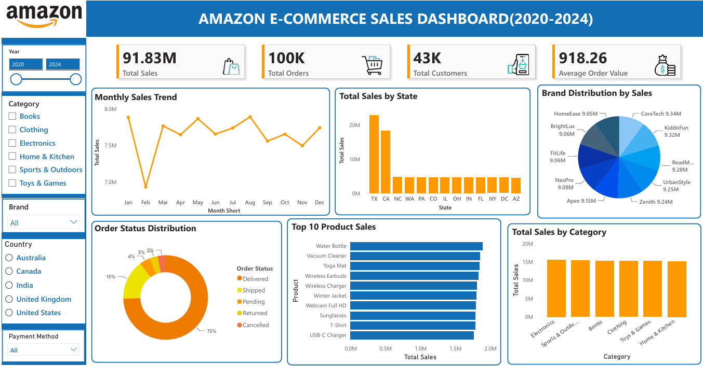

# Amazon E-Commerce Sales Dashboard (2020–2024)

## Project Overview
This Power BI project analyzes Amazon e-commerce sales from 2020 to 2024. The interactive dashboard presents sales performance, customer activity, order status, product performance, and category trends.

## Tools Used
- Microsoft Power BI
- Power Query for data transformation
- Data visualization and interactive filtering
- KPI cards, charts, and slicers

## Dashboard Preview

## Key Performance Indicators
- Total Sales: 91.83M
- Total Orders: 100K
- Total Customers: 43K
- Average Order Value: 918.26

## Dashboard Features
- Monthly sales trend
- Sales by state
- Brand distribution by sales
- Order status distribution
- Top 10 products by sales
- Sales by product category
- Interactive filters for year, category, brand, country, and payment method

## Key Observations
- The dashboard provides a monthly view of sales trends across 2020–2024.
- State-wise sales are led by Texas and California in the displayed chart.
- Water Bottle ranks first among the displayed top 10 products by sales.
- Delivered orders account for approximately 75% of the order status distribution shown.

## Project Files
- `AMAZON DASHBOARD.pbix` — Power BI dashboard file.
- `amazon.png` — Dashboard screenshot.

## How to View
Download the PBIX file and open it in Microsoft Power BI Desktop to explore the report and filters.

## Author
Sathvika Jabisetty
