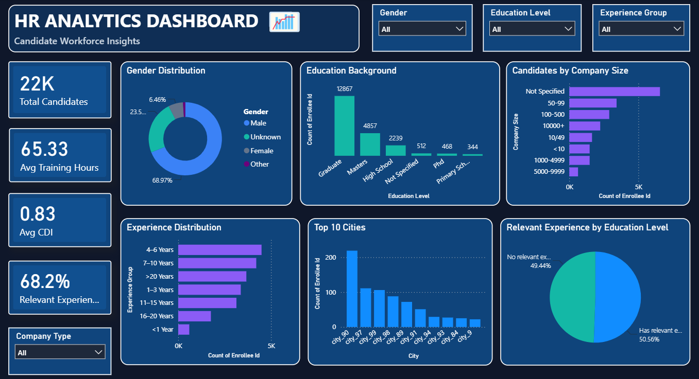

# HR Analytics Dashboard

## Project Overview
The **HR Analytics Dashboard** is an interactive Power BI project that provides insights into candidate demographics, education backgrounds, work experience, and relevant experience. It helps explore workforce and candidate data through visualizations and interactive filters.

## Objectives
- Analyze candidate gender distribution.
- Understand candidates' education backgrounds.
- Explore work experience across different experience groups.
- Compare candidate counts across company sizes and cities.
- Examine relevant experience by education level.
- Provide interactive filtering for deeper analysis.

## Key Metrics
- **Total Candidates:** 22K
- **Average Training Hours:** 65.33
- **Average CDI:** 0.83
- **Relevant Experience:** 68.2%

## Dashboard Features
- **Gender Distribution:** Visualizes the distribution of candidates by gender.
- **Education Background:** Compares candidates across graduate, master's, high school, PhD, and other education categories.
- **Candidates by Company Size:** Shows candidate counts across different company-size groups.
- **Experience Distribution:** Displays candidates across work-experience ranges.
- **Top 10 Cities:** Highlights the cities with the highest candidate counts in the displayed data.
- **Relevant Experience by Education Level:** Compares candidates with and without relevant experience.
- **Interactive Filters:** Filter the dashboard by gender, education level, experience group, and company type.

## Tools & Technologies
- Microsoft Power BI
- Power Query
- Data Visualization
- Data Analysis

## Key Insights
- The dashboard displays approximately **22K candidates**.
- Graduates form the largest education category in the displayed data.
- The **4–6 years** experience group has the highest candidate count among the displayed experience groups.
- The dashboard reports **68.2% relevant experience**.
- The relevant-experience chart shows a nearly even split, with 50.56% having relevant experience and 49.44% not having relevant experience.
- The largest company-size category shown is **Not Specified**.

## Dashboard Preview

## Project Files
- `HR ANALYTICS.pbix` — Power BI dashboard file.
- `HRANALYTICS.png` — Dashboard screenshot.
- `README.md` — Project documentation.

## What I Learned
- Building interactive dashboards in Power BI.
- Creating KPI cards and data visualizations.
- Analyzing candidate demographics and experience data.
- Using slicers to explore data dynamically.
- Presenting analytical findings through a dashboard.

---
**Created by Sathvika Jabisetty**  
*Data Analytics Portfolio Project*

