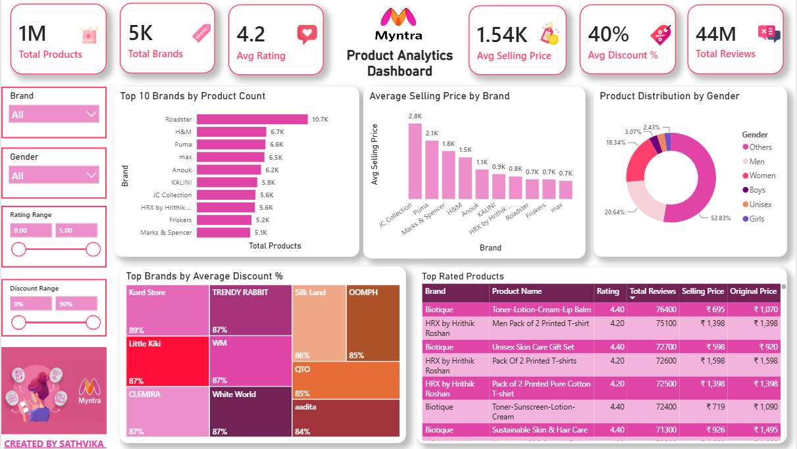

#  Myntra Product Analytics Dashboard

##  Project Overview
The Myntra Product Analytics Dashboard is an interactive Power BI project that analyzes product data, brand performance, pricing, discounts, gender distribution, and customer reviews. It helps explore product trends and compare brands through interactive visualizations.

##  Project Objectives
- Analyze product counts across brands.
- Compare average selling prices between brands.
- Explore product distribution by gender.
- Identify brands offering high average discounts.
- Analyze top-rated products and their customer reviews.
- Enable interactive exploration using slicers and filters.

##  Key Performance Indicators (KPIs)
- **Total Products:** 1M
- **Total Brands:** 5K
- **Average Rating:** 4.2
- **Average Selling Price:** ₹1.54K
- **Average Discount:** 40%
- **Total Reviews:** 44M

##  Dashboard Features

### 1. Top 10 Brands by Product Count
Roadster leads the displayed chart with approximately 10.7K products, followed by H&M and Puma.

### 2. Average Selling Price by Brand
Compares average selling prices across brands. JC Collection has the highest displayed average selling price at approximately ₹2.8K.

### 3. Product Distribution by Gender
The displayed distribution includes:
- Others: 52.83%
- Women: 20.64%
- Men: 18.34%
- Boys: 3.07%
- Girls: 2.43%

### 4. Top Brands by Average Discount
Highlights brands with high average discount percentages. Kord Store shows an average discount of 89% in the displayed chart.

### 5. Top Rated Products
Displays brand, product name, rating, total reviews, selling price, and original price for product comparison.

### 6. Interactive Filters
- Brand
- Gender
- Rating Range
- Discount Range

These filters help users explore the dashboard based on selected criteria.

##  Key Insights
- The dashboard summarizes approximately 1 million products across 5,000 brands.
- The average product rating is 4.2, with approximately 44 million total reviews.
- Roadster has the highest product count among the brands shown.
- JC Collection has the highest average selling price among the displayed brands.
- The overall average discount shown is 40%.
- Biotique appears multiple times in the displayed top-rated products table, with ratings of 4.4.

## Tools & Technologies
- Microsoft Power BI
- Power Query
- Data Analysis
- Data Visualization
- Interactive Dashboard Design

##  Dashboard Preview

##  Project Files
- `MYNTRA.pbix` — Power BI dashboard file.
- `myntra.png` — Dashboard screenshot.
- `README.md` — Project documentation.

##  What I Learned
- Analyzing large product datasets.
- Comparing brand performance, pricing, and discount patterns.
- Creating KPI cards, charts, and product detail tables.
- Using slicers and filters for interactive analysis.
- Presenting findings through a Power BI dashboard.

---
**Created by Sathvika Jabisetty**  
*Data Analytics Portfolio Project*

