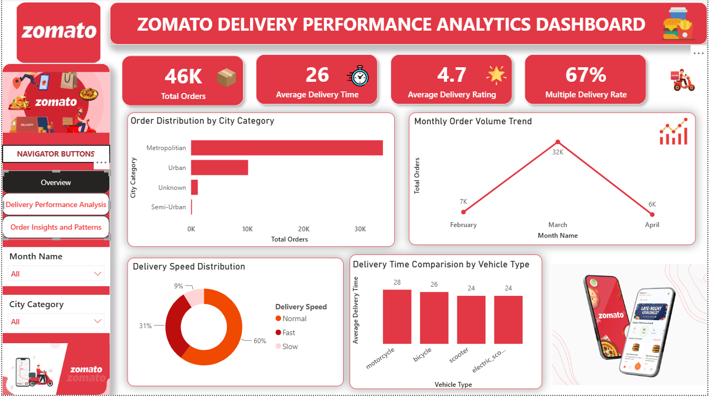

# Zomato Delivery Performance Analysis | Power BI

## Project Overview
This project uses Microsoft Power BI to analyze food delivery performance, customer ratings, order patterns, and operational factors. The interactive dashboard explores how traffic, weather, vehicle condition, and multiple deliveries relate to delivery time.

## Tools & Technologies
- Microsoft Power BI
- Power Query for data cleaning and transformation
- Interactive charts, KPI cards, slicers, and report navigation

## Dashboard Preview

## Key Performance Indicators
- Total Orders: 46K
- Average Delivery Time: 26
- Average Delivery Rating: 4.7
- Multiple Delivery Rate: 67%

## Dashboard Features
- Delivery performance analysis
- Monthly order trends
- Delivery time by weather and traffic conditions
- Vehicle condition analysis
- Customer ratings and delivery time comparison
- Order patterns by time, day, and type
- Festival vs. non-festival order comparison
- Interactive filters and report navigation

## Key Insights
- **Monthly orders:** March shows approximately 32K orders in the displayed trend, compared with 7K in February and 6K in April.
- **Weather:** Cloudy and foggy conditions show an average delivery time of 29, while sunny conditions show 22.
- **Traffic:** Jam conditions show the highest average delivery time at 31; low traffic shows 21.
- **Vehicle condition:** Poor vehicle condition shows an average delivery time of 30, compared with 24 for good and average conditions.
- **Multiple deliveries:** The dashboard indicates that average delivery time increases as the number of multiple deliveries increases.
- **Customer ratings:** The displayed scatter plot suggests that longer delivery times are associated with lower ratings.
- **Order patterns:** Evening is the peak ordering period, snacks are the most ordered type, and Friday has the highest order volume in the displayed charts.
- **Festival orders:** The dashboard shows 896 festival-related orders and 44,460 non-festival orders.

These are observations from the dashboard visuals and do not establish causation.

## Project Files
- `zomato dashboard.pbix` — Power BI report file.
- `zomato.png` — Dashboard screenshot.
- `zomato.mp4` — Dashboard walkthrough video.

## How to View
Download the PBIX file and open it in Microsoft Power BI Desktop to explore the report and its interactive filters.

## Author
Sathvika Jabisetty
